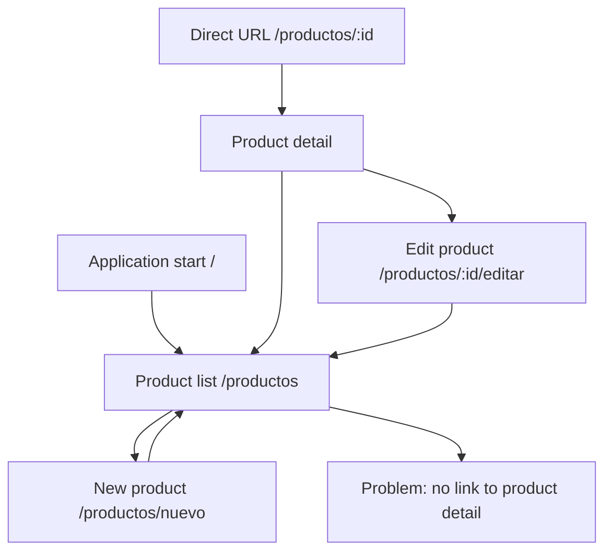

# CP1 — UX Audit: Attendance Control

## 1. Project context

Attendance Control manages courses, class sessions and attendance registration using QR codes.

The backend currently supports attendance history, attendance registration and attendance consultation by class.

The mobile frontend is not implemented yet. The official Ionic React starter is therefore used as the baseline for this workshop.

This audit evaluates the existing starter screens and identifies the changes required for the attendance workflow.

## 2. Selected screens

| Current screen | Planned attendance screen |
|---|---|
| Product list (`/productos`) | Student attendance history |
| Product detail (`/productos/:id`) | Attendance record detail |
| Product form (`/productos/nuevo`) | QR attendance registration |

The original screens are not yet connected to the Attendance Control backend.

## 3. UX findings

| # | Screen | Problem | UX principle | Severity | Proposed improvement |
|---|---|---|---|---|---|
| 1 | List | The main title identifies products instead of attendance records. | Clarity and consistency | High | Rename the section to Attendance History. |
| 2 | List | Loading is displayed as plain text instead of placeholders that represent the rows. | System status visibility | Medium | Introduce skeleton rows with the attendance layout. |
| 3 | List | An empty response produces an empty list without guidance. | Empty-state feedback | High | Explain that no attendance has been recorded and offer a useful action. |
| 4 | List | The rows are not linked to a detail route. | Navigation and discoverability | High | Make each attendance record open its detail. |
| 5 | List | Rows show only the product name, which does not represent attendance information. | Information hierarchy | High | Display courseName, dateTime and record identification. |
| 6 | Detail | The screen displays a TODO placeholder instead of record information. | Content clarity | High | Show the selected attendance record and its course. |
| 7 | Form | The form only contains a product name field and has no registration action. | Task completion | High | Replace it with a QR code registration flow and confirmation feedback. |
| 8 | Navigation | The initial route opens the product catalog and provides no attendance-specific destinations. | Navigation consistency | High | Create navigation based on the attendance workflow. |
| 9 | Data integration | The frontend consumes product services, not the attendance endpoints. | Domain coherence | High | Introduce an attendance data service matching the backend contract. |

## 4. Existing positive behavior

The product list already handles request errors and provides a Retry button.

This behavior should be preserved and adapted to attendance records instead of being implemented as if it did not exist.

The detail and form screens already include back navigation. This is a useful starting point.

## 5. Current navigation map

The main navigation problem is that the list does not provide a direct path to its detail screen.

Users also cannot perform any attendance-related task from the initial application.

## 6. Attendance Control domain references

Real backend operations:

- `GET /api/attendance/history`: retrieves the authenticated student's attendance history.
- `POST /api/attendance/register`: registers attendance using a QR code.
- `GET /api/attendance/class/{classSessionId}`: retrieves attendance records for a class.

The attendance response includes fields such as `id`, `courseName`, `classSessionId` and `dateTime`.

These elements will guide the future screen design.

## 7. Priority

The first priority is replacing the product list with the student attendance history, including loading, empty and error states.

The second priority is defining navigation that connects attendance history, record detail and QR registration.

The third priority is improving visual hierarchy and accessibility without changing the backend contract.

## 8. Baseline screenshots

### Current list

### Current form

### Current detail

## 9. CP1 conclusion

The existing frontend provides a technical starting point, but its screens still represent a product catalog.

The proposed changes will focus on the real attendance domain and the student workflow. Navigation and screen-state improvements will be implemented in the following checkpoints.
