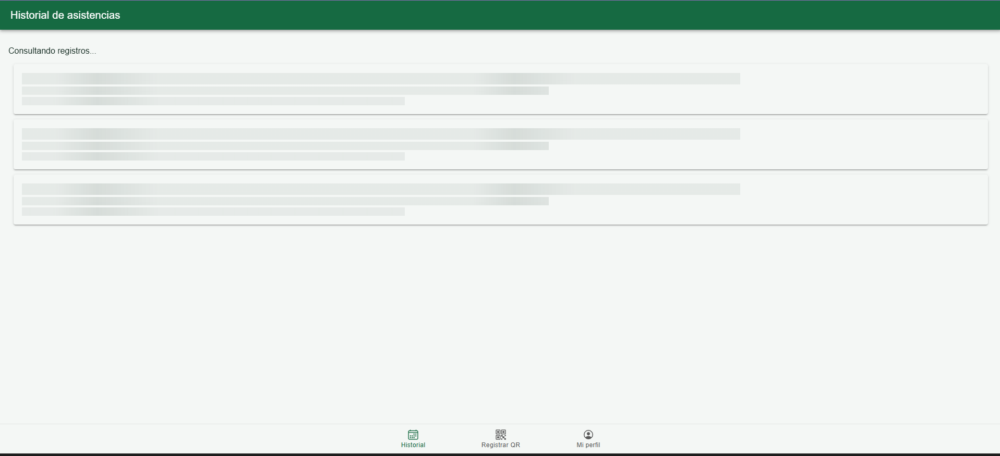
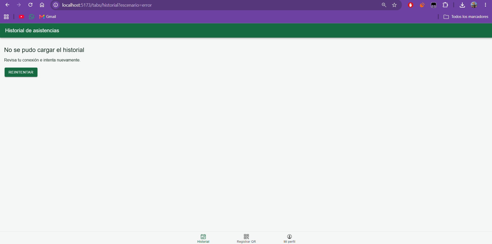
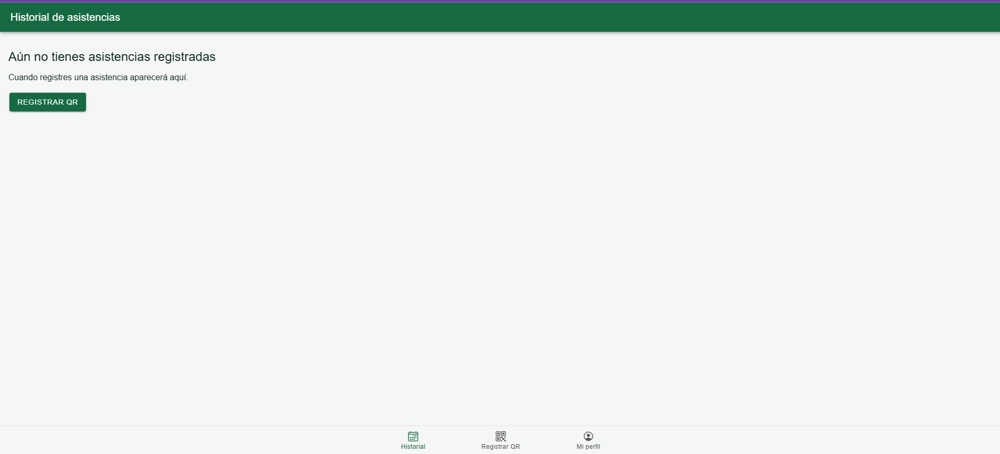
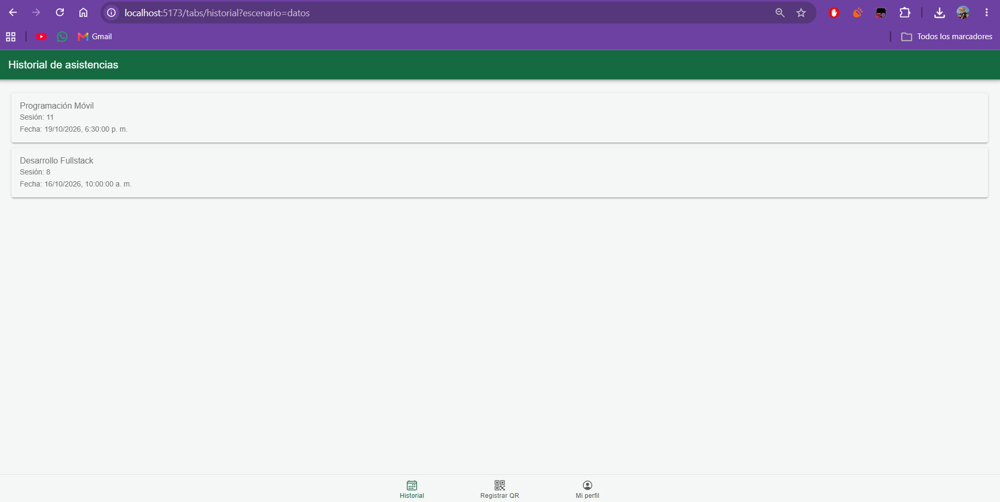

# CP3 — Attendance History States

## Overview

The attendance history screen displays feedback while requesting attendance records.

The frontend currently uses simulated data until the Spring Boot backend is integrated.

## Implemented states

| State | Behavior | Test scenario |
|---|---|---|
| Loading | Displays skeleton cards | Initial request |
| Data | Displays course and session records | `escenario=datos` |
| Empty | Shows guidance and QR registration action | `escenario=vacio` |
| Error | Shows a message and Retry button | `escenario=error` |

## Data reference

The screen represents student attendance using:

- `courseName`: name of the course
- `classSessionId`: class session identifier
- `dateTime`: attendance date and time

Future integration: `GET /api/attendance/history`.

## Refresh behavior

IonRefresher allows the student to request updated records by pulling down the list.

The Retry button starts another request after an error.

## Automated test

`AttendanceHistoryPage.test.tsx` checks the error message and verifies that Retry invokes the data service again.

## Screenshots

### Loading

### Attendance records

### Empty history

### Request error

## Current limitation

Attendance records are simulated and are not yet persisted or retrieved from the team's backend.
