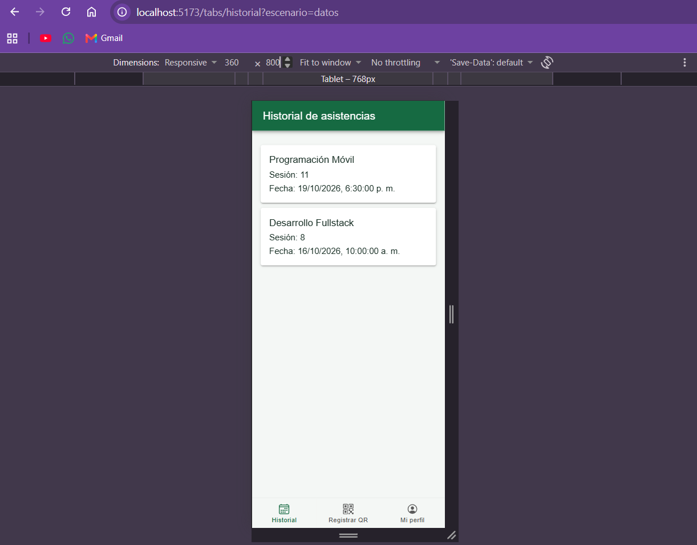
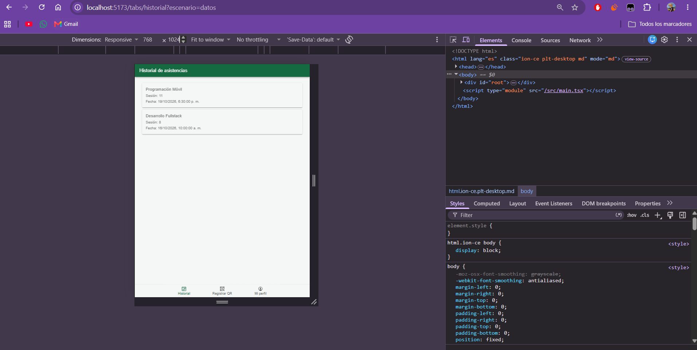

# CP4 — Accessibility and Responsive Design

## 1. Objective

This checkpoint focuses on improving accessibility and responsive design in Attendance Control, a mobile application for managing student attendance through QR codes.

The main objective is to improve readability, navigation, and usability across different screen sizes.

## 2. Reviewed Screens

The following screens were considered:

- Attendance History
- QR Registration
- Student Profile

The main accessibility improvements were applied to the Attendance History screen, which displays course names, class session identifiers, and attendance dates.

The application currently uses simulated attendance records while backend integration is pending.

## 3. Accessibility Improvements

| Element | Identified Problem | Implemented Improvement |
|---|---|---|
| Attendance cards | Insufficient text contrast | White background and dark green text |
| Viewport | Restricted browser zoom | Removed zoom restrictions |
| Bottom navigation | Navigation labels needed clarification | Added descriptive aria-label attributes |
| Loading state | Limited accessibility feedback | Added role="status" and aria-live |
| Empty state | Missing accessible status announcement | Added accessible feedback |
| Error state | Users need clear recovery options | Error message and Retry button |
| Touch targets | Buttons must be easy to interact with | Minimum height of 44 px |
| Typography | Text needs to adapt to different devices | Relative font sizes using rem |

## 4. Design Tokens and Contrast

The original green design was preserved while improving text readability.

| Element | Color |
|---|---|
| Primary color | #166A42 |
| Card text | #152C22 |
| Card background | #FFFFFF |
| Application background | #F4F7F5 |

Using dark green text on white cards improves the readability of course names, session numbers, and attendance dates.

## 5. Responsive Design

Two viewport sizes were selected for responsive testing.

| Device | Resolution | Verification |
|---|---|---|
| Small smartphone | 360 x 800 px | Check card layout, text readability, and bottom navigation |
| Tablet | 768 x 1024 px | Cards remain aligned and navigation is visible |

CSS rules were added to control the maximum width of attendance cards, improve text wrapping, and maintain appropriate touch target sizes.

## 6. Lighthouse Accessibility Results

Accessibility was evaluated using Chrome DevTools Lighthouse.

| Measurement | Accessibility Score |
|---|---|
| Before improvements | 89/100 |
| After improvements | 100/100 |
| Score improvement | +11 points |

### Initial Issues

The first Lighthouse audit identified two accessibility problems:

1. The viewport configuration restricted browser zoom.
2. Some attendance card texts had insufficient contrast against their background.

### Applied Solutions

The viewport configuration in `index.html` was updated to allow browser zoom.

The attendance card styles in `variables.css` were modified to use a white background and dark text.

After these changes, the Lighthouse accessibility score increased from 89 to 100.

The score reflects automated accessibility checks and does not replace manual accessibility testing.

## 7. Screenshots

### Small Smartphone — 360 px

### Tablet — 768 px

### Lighthouse Results

Initial accessibility score: 89/100.

Final accessibility score: 100/100.

The Lighthouse reports demonstrate the improvement achieved after fixing viewport scaling and text contrast issues.

## 8. Technical Verification

The accessibility and responsive improvements involved the following files:

- `src/app/App.tsx`
- `src/app/theme/variables.css`
- `src/features/attendance/presentation/AttendanceHistoryPage.tsx`
- `index.html`

The project should be validated with the following commands before committing:

- `npm run build`
- `npm test -- --run`

## 9. Conclusion

The accessibility improvements made the Attendance History screen easier to read and interact with.

The Lighthouse score increased from 89 to 100 after correcting contrast and viewport configuration issues.

The application maintains its green visual identity and bottom navigation structure.

Future improvements will include manual accessibility testing, real QR scanning, and integration with the Attendance Control backend.
