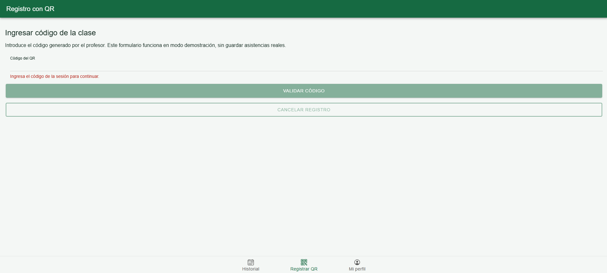
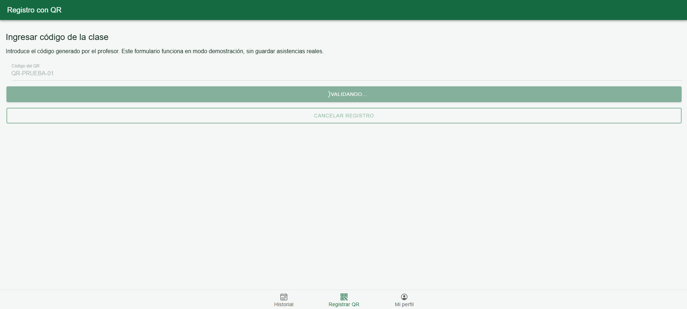
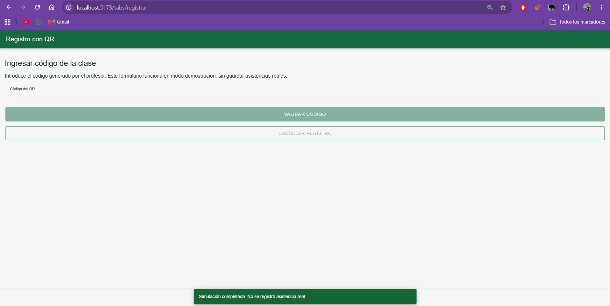
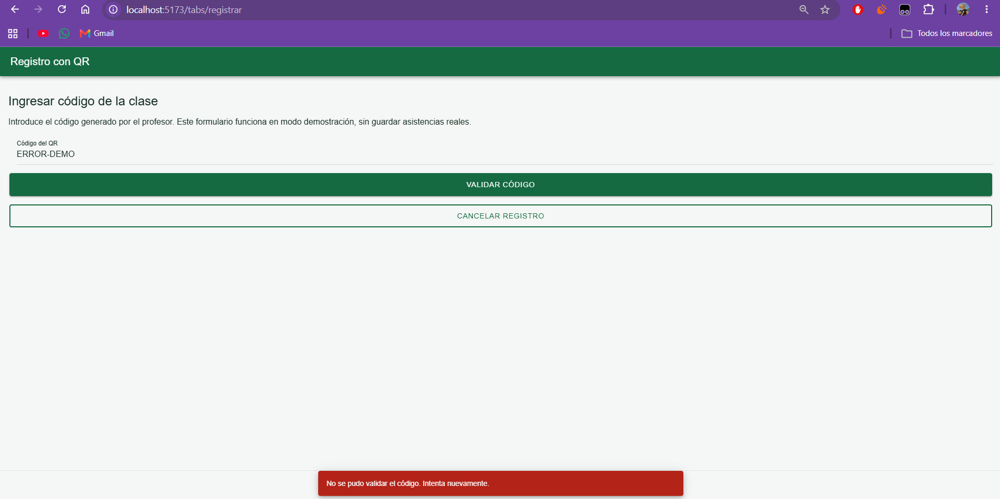
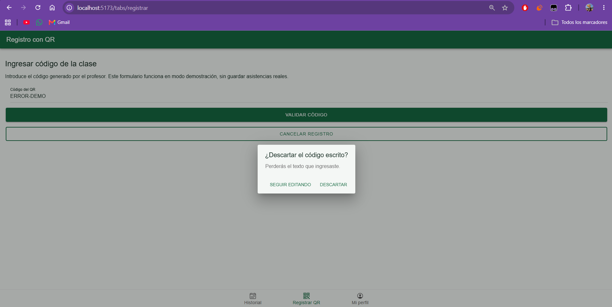

# CP6 — QR Attendance Registration Form

## 1. Objective

Improve the QR attendance registration experience through field validation, loading feedback, error messages, and cancellation confirmation.

## 2. Backend Contract

The existing Spring Boot backend provides:

- Endpoint: `POST /api/attendance/register`
- Request body: `{ "code": "..." }`
- Authentication: required

The request requires a non-blank QR code. Student identification is handled through authentication, not through an additional form field.

## 3. Validation Rules

| Field | Rule | Reason |
|---|---|---|
| QR code | Required | The backend requires a non-blank code |
| QR code | Trim surrounding whitespace | Prevent whitespace-only submissions |

The frontend does not impose an unsupported QR code format or length restriction.

## 4. User Feedback

| State | Behavior |
|---|---|
| Empty input | Displays a validation message after interaction |
| Invalid input | Submit button remains disabled |
| Submitting | Displays a loading indicator |
| Demo success | Displays a success toast |
| Demo error | Displays an error toast |
| Cancellation | Requires confirmation before discarding input |

## 5. Demonstration Mode

The form currently operates without backend persistence.

- `QR-PRUEBA-01` demonstrates a successful interface response.
- `ERROR-DEMO` demonstrates a request failure.
- No real attendance is registered.
- Camera-based QR scanning and authenticated API integration remain pending.

## 6. Evidence

### Validation

### Loading

### Success feedback

### Error feedback

### Cancellation confirmation

## 7. Verification

The implementation should be verified using:

- `npm run build`
- `npm test -- --run`

All screenshots must be captured from the running application.

## 8. Pending Integration

The form will later connect to the authenticated Attendance Control backend.

The backend will be responsible for validating code existence, expiration, and duplicate attendance registration.
