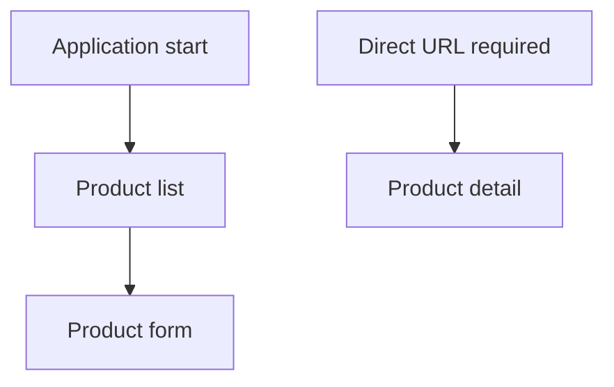
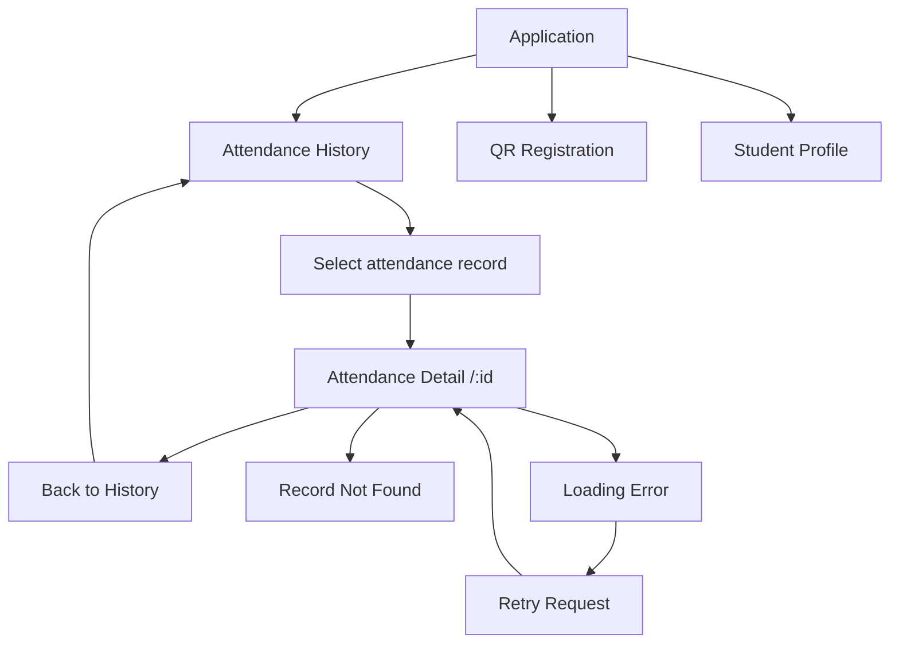
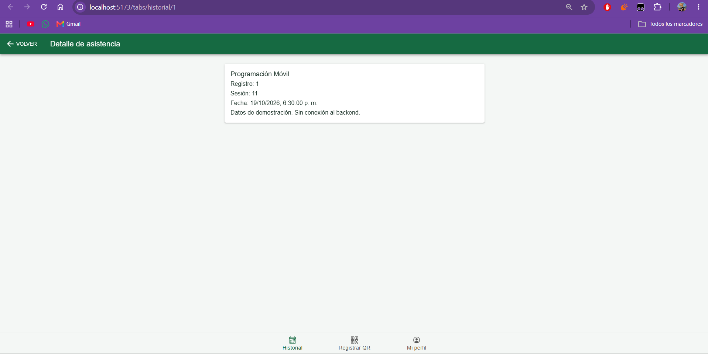
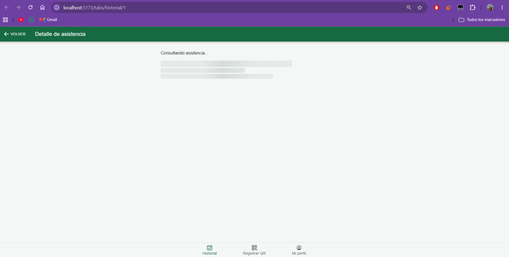
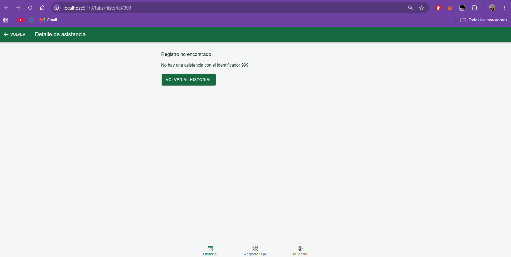
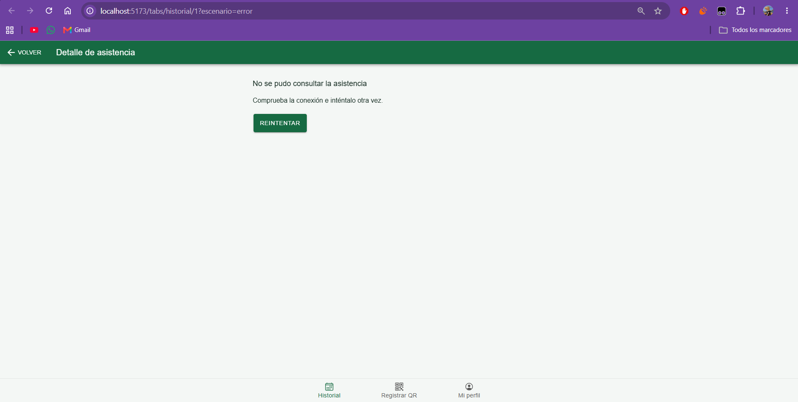

# CP7 — Attendance Detail and Navigation Flow

## 1. Objective

Improve navigation in Attendance Control by connecting the attendance history to a detail screen using the attendance record ID.

## 2. Previous Navigation

During CP1, the Ionic React starter used a product catalog. The product list did not provide direct access to the detail screen.

## 3. Updated Navigation

The application now provides attendance-specific navigation.

## 4. Detail Screen

Route: `/tabs/historial/:id`

The screen reads the attendance identifier from the URL and searches for the matching record.

Displayed fields:

- `id`: attendance record identifier
- `courseName`: course name
- `classSessionId`: class session identifier
- `dateTime`: attendance registration date

## 5. Screen States

| State | Behavior |
|---|---|
| Loading | Displays skeleton placeholders |
| Ready | Displays the selected attendance information |
| Error | Displays an error message and Retry button |
| Not found | Explains that the requested record does not exist |

## 6. Navigation Comparison

| Before CP7 | After CP7 |
|---|---|
| Product-oriented navigation | Attendance-oriented navigation |
| Detail required direct URL access | Detail opens from the attendance list |
| No record-specific student workflow | Selected attendance ID determines the detail |
| No implemented attendance detail states | Loading, ready, error, and not-found states |

The user can now reach the selected attendance detail with one action from the history list instead of entering a detail URL manually.

## 7. Evidence

### Attendance Detail

### Loading State

### Record Not Found

### Error State

## 8. Current Limitations

The application still uses simulated attendance data.

Future work includes authenticated backend integration and retrieving attendance records from the actual Attendance Control API.
