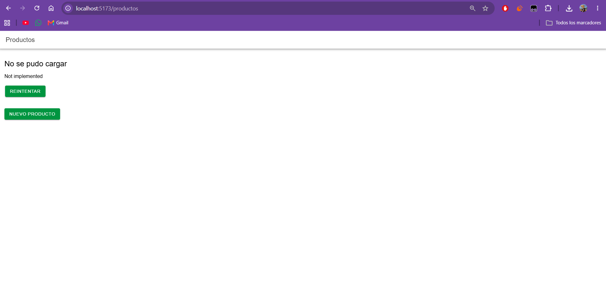
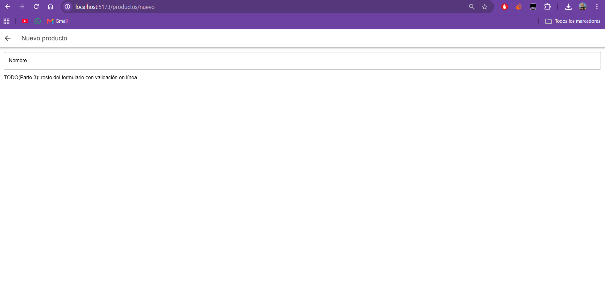
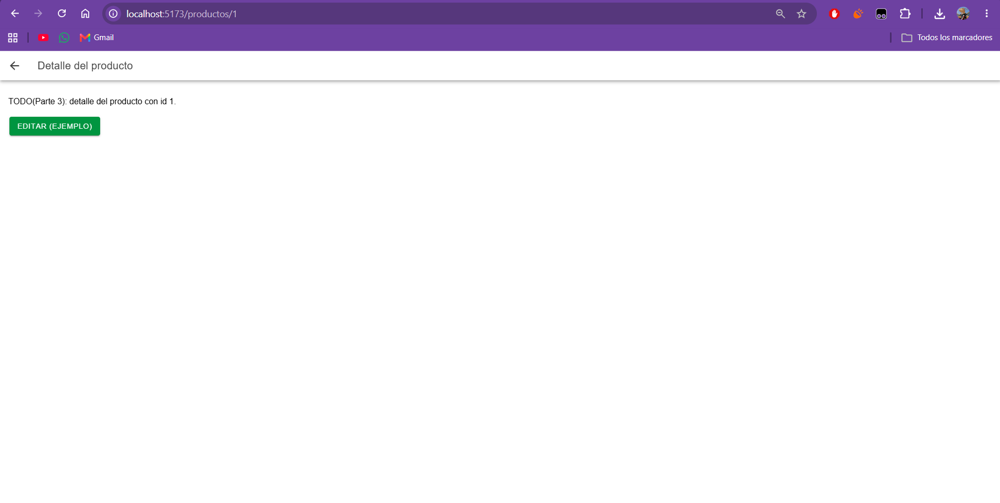

# CP9 — Before and After Comparison

## 1. Objective

This checkpoint documents the UX/UI improvements implemented in Attendance Control during the Week 11 workshop.

The comparison uses screenshots from the original Ionic React starter and the updated attendance prototype.

The focus is on attendance history, QR registration, and attendance record details.

## 2. Before and After Screens

### 2.1. Attendance History

| Before — Product List | After — Attendance History |
|---|---|
|  |  |

**Changes:** The original product list was adapted to display attendance records using `courseName`, `classSessionId`, and `dateTime`. Loading, empty, and error states were also implemented.

**UX principles:** Information hierarchy, system status visibility, and error prevention.

### 2.2. QR Registration

| Before — Product Form | After — QR Registration |
|---|---|
|  |  |

**Changes:** The product form was replaced with a QR code validation interface. The new form provides field validation, submission feedback, cancellation confirmation, and persistent error messages.

**UX principles:** Error prevention, user feedback, and consistency.

### 2.3. Attendance Detail

| Before — Product Detail | After — Attendance Detail |
|---|---|
|  |  |

**Changes:** The original detail placeholder was replaced with an attendance detail screen using the record ID from the route `/tabs/historial/:id`.

**UX principles:** Navigation clarity, content hierarchy, and visibility of system status.

## 3. Navigation Improvements

### Before

The original starter provided product-related routes and did not connect the product list directly to its detail page.

### After

Attendance Control now includes:

- Student attendance history.
- QR registration.
- Student profile.
- Attendance record detail.
- Back navigation to the history screen.

A student can open a specific attendance record directly from the history list.

## 4. Accessibility Improvements

The application was reviewed at 360 px and 768 px.

Improvements included:

- Descriptive navigation labels.
- Minimum touch target heights.
- Responsive attendance cards.
- Improved text contrast.
- Accessible loading and error feedback.
- Browser zoom support.

Lighthouse accessibility increased from 89/100 to 100/100 during CP4.

## 5. Usability Test Evidence

Two participants completed three tasks each.

| Task | Average Time |
|---|---|
| QR registration validation | 32 seconds |
| Attendance detail navigation | 37 seconds |
| Error recovery | 43.5 seconds |

All six tasks were completed without reported errors.

Error recovery was the slowest task, so persistent inline validation feedback was added as a preventive improvement.

## 6. User Stories for the Team Backlog

### US-W11-01 — Student Attendance History

**As a** student,
**I want** to review my attendance records,
**so that** I can identify the courses and class sessions I have attended.

**Acceptance Criteria:**

- AC1: The screen requests data from `GET /api/attendance/history` using the authenticated session.
- AC2: Each record displays `courseName`, `classSessionId`, and `dateTime`.
- AC3: Loading displays skeleton placeholders.
- AC4: An empty result displays a message and a QR registration action.
- AC5: Request failures display an error and a Retry button.
- AC6: Simulated records are not presented as real attendance data.

### US-W11-02 — Attendance Record Detail

**As a** student,
**I want** to open an attendance record from my history,
**so that** I can review the information of a specific class session.

**Acceptance Criteria:**

- AC1: Selecting a record opens `/tabs/historial/:id`.
- AC2: The detail screen displays the record matching the selected ID.
- AC3: The detail includes the course name, session ID, and date.
- AC4: A missing record displays a clear Not Found state.
- AC5: Request errors provide a Retry action.
- AC6: The user can return to Attendance History.

### US-W11-03 — QR Attendance Registration

**As a** student,
**I want** to register attendance with a QR code,
**so that** my attendance can be recorded for the corresponding class session.

**Acceptance Criteria:**

- AC1: The QR code field rejects blank or whitespace-only input.
- AC2: The submit button remains disabled while the field is invalid or a request is in progress.
- AC3: Registration uses authenticated `POST /api/attendance/register` with the `code` field.
- AC4: Success feedback is displayed only after the backend confirms registration.
- AC5: Failed requests display persistent error feedback without discarding the entered code.
- AC6: Discarding an entered code requires user confirmation.

## 7. Implementation Status

The Week 11 frontend is a working UX/UI prototype.

Implemented:

- Attendance-oriented navigation.
- Simulated attendance history.
- Attendance detail using route parameters.
- QR form validation and feedback.
- Responsive and accessible interface states.
- Automated error and retry testing.

Pending:

- Real backend authentication and integration.
- Persistent attendance records.
- Camera-based QR scanning.
- End-to-end validation of attendance registration.

## 8. Conclusion

The workshop transformed the original Ionic React starter into a prototype focused on the student attendance experience.

The interface now provides clearer navigation, attendance-specific information, validation feedback, and accessible screen states.

The next development stage is integrating these improvements with the team's existing Spring Boot backend.
